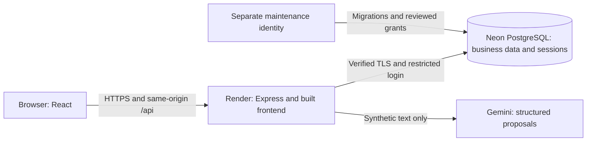

# ForgeQuote

Manufacturing RFQ-to-quotation software with evidence-backed intake, deterministic costing and an auditable approval trail.

**[Open ForgeQuote](https://forgequote-demo.onrender.com)** · **[GitHub repository](https://github.com/Pragun3691/ForgeQuote)**

ForgeQuote takes a reviewed request for quotation (RFQ) through multi-component pricing, Sales Head clearance and estimator issuance. Every saved version preserves its inputs, historical rates and calculated results, so a later rate change cannot silently rewrite an earlier quotation.

The hosted application uses synthetic data and two shared accounts. Account passwords are supplied privately to evaluators; they are not published here. No personal Gemini API key is required to use the hosted application.

<!-- Insert final synthetic-data screenshots here after the owner-approved UI/UX redesign. -->

## Why ForgeQuote

Manufacturing prices depend on material weight, machine time, setup, allowances, freight and margin. When these inputs live across spreadsheets and emails, it becomes difficult to explain an old price, recover a failed save or establish which version was approved.

ForgeQuote connects those decisions: reviewed source facts become an RFQ, date-selected rates become a saved calculation, and approval authorizes that exact quotation version. AI assists data entry; it never calculates authoritative prices or approves a quotation.

## Capabilities

- **Two roles:** Estimators register, cost, submit and issue quotations. Sales Heads approve/reject, append rate versions and record RFQ outcomes.
- **Three intake paths:** Manual entry, real Gemini-assisted text extraction, and deterministic Excel part-list import.
- **Human review:** Source quotes, component association and normalized values remain inspectable; estimators correct proposals and select internal rate keys before saving.
- **Multi-part costing:** Price 1–20 components at three editable annual quantities, defaulting to 50%, 100% and 150%.
- **Historical rates:** Inspect six rate categories and effective periods; Sales Heads append validated versions with a reason and author attribution.
- **Immutable quotations:** Preserve rate IDs/values, routing, inputs, formula version, rounded lines and scenario totals. Recalculation creates a new version.
- **Controlled lifecycle:** Combined annual value above ₹25 lakh excluding GST requires Sales Head approval. Estimators issue cleared versions; RFQs derive estimating/sent status and support terminal won/lost outcomes.
- **Separate PDFs:** An issued customer quotation presents selling prices and GST. A confidential internal PDF explains saved costs, margins and rate provenance, including historical versions.
- **Reliable writes and security:** Transactional idempotency, concurrent-action protection, PostgreSQL sessions, server-side roles, Origin/CSRF checks and restricted runtime grants.

## Technology stack

| Area | Implementation |
| --- | --- |
| Frontend | React, Vite, JavaScript |
| API | Node.js 24, Express 5, explicit SQL through `pg` |
| Financial engine | `decimal.js`, PostgreSQL NUMERIC, decimal-string transport |
| Persistence and sessions | PostgreSQL; Neon for hosted storage; `connect-pg-simple` sessions |
| Intake | Google Gemini through `@google/genai` and Zod; bounded XLSX ZIP/XML parser in a worker |
| PDFs and tests | PDFKit, bundled Noto Sans; Node test runner, real PostgreSQL fixtures, Playwright/Chrome and PDF.js |
| Hosting | One Render Node service serving the frontend and API on one HTTPS origin |

## Architecture



The API validates inputs, resolves historical rates, calculates prices and commits complete snapshots. React displays saved server results. Customer PDFs receive an explicit field allowlist; internal manufacturing data never enters the customer renderer.

A separate maintenance identity owns schema changes, grants and seeding. The runtime cannot perform DDL. Same-origin hosting simplifies secure cookies and exact-Origin checks without a separate cross-origin frontend deployment.

## Application workflow

1. **Register:** Enter an RFQ manually or review Gemini/Excel proposals, complete manufacturing fields and select real rate keys.
2. **Calculate:** Choose a pricing date, routing revision, margin and three quantities for every component. Save one complete quotation version.
3. **Review:** Inspect component costs, combined totals and saved rate provenance. Download internal costing evidence if needed.
4. **Clear:** Submit the current version. At/below ₹25 lakh annual ex-GST clears automatically; above it requires Sales Head approval. A rejection requires a reason.
5. **Issue:** The estimator issues the cleared current version and downloads its customer PDF. A new version receives no inherited approval.
6. **Close:** Issuance makes the RFQ `sent`; Sales Head can record `won` or `lost` with a required lost reason. "Sent" means issued, not email-delivered.

If a save response is lost, retry the same stored request key and body. A matching retry recovers the original result; changing intent under that key conflicts instead of silently creating another record.

## Financial correctness and history

Money uses Decimal arithmetic and string transport, never JavaScript binary floats. The engine rounds each cost line HALF_UP to paise, sums those lines, and derives selling price using **gross margin on selling price**:

```text
selling price = round_paise(manufacturing cost / (1 - margin_percent / 100))
```

For the independently specified spindle golden case dated **2 November 2026**, material at ₹100/kg gives **₹119.76 cost/unit**, **₹149.70 selling/unit** at 20% margin, and **₹2,69,46,000.00 annual ex-GST** for 180,000 units. See the [nine golden cases](docs/golden-cases.md) and [costing contract](docs/costing-spec.md).

The owner verified a hosted EN8 update to **₹105/kg effective 6 November**. New calculations on that date resolve the new version; older saved quotations retain their original ₹100 rate and outputs. A fresh local seed contains the November 2 version only.

Gross margin, line rounding, at most 12 setup batches/year, default scenario quantities and below-threshold automatic clearance are documented demo assumptions. Illustrative GST is 18%, calculated on the combined quotation subtotal; this is not invoice-tax compliance. Missing historical rates visibly block pricing rather than defaulting to zero.

## Local development

### Prerequisites

Use **Node.js 24.20.0** (pinned), npm, **PostgreSQL 17** and `psql` on PATH. Recorded local database tests used PostgreSQL 17.11. Chrome is needed for browser suites; OpenSSL on PATH is needed for TLS tests in the unit suite.

### 1. Install

```powershell
git clone https://github.com/Pragun3691/ForgeQuote.git
Set-Location ForgeQuote
npm.cmd ci
```

### 2. Prepare a fresh local database

The following assumes a local maintenance administrator named `postgres` on port 5432. Passwords are entered at prompts, never embedded in commands:

```powershell
psql -X -W -h localhost -U postgres -d postgres --set=ON_ERROR_STOP=on -c "CREATE ROLE forgequote_app LOGIN NOINHERIT NOSUPERUSER NOCREATEDB NOCREATEROLE NOREPLICATION NOBYPASSRLS"
psql -X -W -h localhost -U postgres -d postgres --set=ON_ERROR_STOP=on -c '\password forgequote_app'
psql -X -W -h localhost -U postgres -d postgres --set=ON_ERROR_STOP=on -c "CREATE DATABASE forgequote_dev OWNER postgres"
```

For `\password`, authenticate as the administrator, then choose and confirm a private runtime password. Keep database/table ownership with maintenance; the local grant script expects runtime role `forgequote_app`. If these objects already exist, verify them instead of dropping, resetting or recreating them. Stop on an error; never elevate the runtime role as a workaround.

### 3. Configure

Create an ignored root `.env` using your own local values. [`.env.example`](.env.example) lists variable names; omit unused blank entries.

| Variable | Local purpose/setting |
| --- | --- |
| `DATABASE_URL` | Private runtime PostgreSQL URL for `forgequote_app` and `forgequote_dev` |
| `MIGRATION_DATABASE_URL` | Private maintenance URL: same host, port and database, different role |
| `SESSION_SECRET` | Private random secret containing at least 32 bytes |
| `APP_ORIGIN` | `http://127.0.0.1:5173`, no trailing slash |
| `NODE_ENV`, `PORT` | `development`, `3000` |
| `DATABASE_TLS_MODE`, `TRUST_PROXY_HOPS` | `disable` for loopback-only local PostgreSQL, `0` locally |
| `DEMO_GST_PERCENT` | `18`, illustrative |
| `DEMO_ESTIMATOR_PASSWORD`, `DEMO_SALES_HEAD_PASSWORD` | Distinct private application passwords for seeding: at least 12 characters, at most 256 UTF-8 bytes |

Maintenance and runtime URLs must use identical hostname/port/database spelling. URL-encode credential characters. Do not publish `.env`, connection strings or secrets.

**Optional local AI:** Configure server-only `AI_API_KEY` to enable Gemini in your own installation. `AI_MODEL` defaults to `gemini-3.5-flash-lite`; `AI_TIMEOUT_MS` defaults to `20000`. Manual/Excel intake, costing and PDFs work without a key. Never put secrets in `VITE_*` variables.

### 4. Migrate, grant and seed

```powershell
npm.cmd run db:migrate
npm.cmd run db:grant-runtime
npm.cmd run db:check-permissions
npm.cmd run db:seed
npm.cmd run db:seed-users
```

Migrations apply through **007**. Seeding creates the synthetic spindle RFQ/rates and the `estimator`/`sales_head` application identities. Sign in with the local passwords chosen above. Repeated seeding validates existing records; it does not reset passwords or overwrite drift.

### 5. Start

In separate PowerShell terminals at the repository root:

```powershell
# Terminal 1
npm.cmd run dev:api
```

```powershell
# Terminal 2
npm.cmd run dev:web
```

Open **http://127.0.0.1:5173**. Vite proxies `/api` to port 3000. Use the exact configured origin; if 5173 is occupied, free it or deliberately update `APP_ORIGIN` and restart the API.

For a local built frontend, stop the development API, change `APP_ORIGIN` to `http://127.0.0.1:3000`, retain `NODE_ENV=development`, and run:

```powershell
npm.cmd run build
npm.cmd start
```

Render uses `npm ci --include=dev && npm run build` and `npm start`. Production requires HTTPS, verified PostgreSQL TLS and private runtime settings; it does not load `.env` or run migrations/seeds at startup. Maintenance/test/seed credentials are rejected in the production app environment. `/api/health/live` checks the process; `/api/health/ready` checks database access and migration 007.

## Testing and verification

Tests cover independent financial expectations, real restricted-PostgreSQL transactions, roles/CSRF/TLS, historical snapshots, concurrency, uncertain-save recovery, AI evidence, workbook limits and PDF confidentiality/layout. Browser suites exercise actual workflows; normal AI suites mock the provider rather than claim live connectivity.

```powershell
npm.cmd run check:api
npm.cmd run test:costing
npm.cmd test
npm.cmd run test:db
npm.cmd run build
npm.cmd run test:production
npm.cmd run test:browser:final
```

For database/browser tests, first create a dedicated local `forgequote_test` database and configure `TEST_DATABASE_URL` targeting it. Fixtures require maintenance permissions to create disposable schemas/roles and, in some suites, databases. Browser tests also need the built frontend and Chrome. Never target production.

**Recorded passing results**, rather than newly executed results from this README edit:

| Evidence | Result |
| --- | --- |
| Latest diagnostics regression | 90/90 unit/config/parser/PDF tests; 24/24 focused DB/API/auth results; 47 syntax modules; build and production-startup test passed |
| Full final-workflow regression | 137/137 PostgreSQL/API reported results; ten Chrome suites; build/startup passed |
| Financial suite | 33/33, including nine independently specified golden scenarios |

Counts overlap and include parent tests; they must not be added into a unique-test total. Details are in the [final-workflow evidence](docs/final-requirements-handoff.md) and [Gemini diagnostics evidence](docs/gemini-diagnostics-handoff.md).

The owner manually verified Render/Neon intake, historical rates, approval, issuance, PDFs and outcomes, and confirmed deployed/main commit `ea03010` on 6 November 2026. Those live observations are distinct from automated local results and do not establish an availability guarantee.

## Architectural decisions

- [Financial policy](docs/decisions/0002-financial-policy.md): explicit rounding, gross margin, setup allocation and approval assumptions.
- [Effective-start rate history](docs/decisions/0003-rate-history.md) and [immutable snapshots](docs/decisions/0005-quotation-snapshots.md): preserve both master history and the actual saved calculation.
- [Transactional idempotency](docs/decisions/0006-http-submission-idempotency.md): recover committed writes after lost responses.
- [Gemini proposals and evidence](docs/decisions/0009-gemini-extraction.md): strict schema/source checks with human financial authority.
- [Version-bound approval](docs/decisions/0014-approval-issuance.md) and [customer PDF allowlist](docs/decisions/0015-customer-quotation-pdf.md): bind decisions to exact prices and protect internal costs.
- [Rate authoring, outcomes and internal reports](docs/decisions/0017-final-requirements.md): narrow append-only writes with explicit limitations.

ADRs and handoffs preserve decisions at their original checkpoints; later accepted extensions supersede earlier scope restrictions.

## Limitations and data policy

- **Synthetic data only.** Gemini input must be nonconfidential and contain no real personal data or NDA-covered drawings. Explicit synthetic-data attestation and processing consent are required; [ADR-0009](docs/decisions/0009-gemini-extraction.md) records the provider-policy review.
- **AI remains fallible.** Literal evidence verification is not universal semantic correctness. Provider timeouts/quota failures remain possible; manual entry is the visible fallback. Unconfirmed source/evidence is transient.
- **Bounded intake/manufacturing:** Pasted text and template-based `.xlsx`, not PDF/OCR or arbitrary workbooks; one operation per routing revision. Excel import is not historical quotation import.
- **Narrow business policies:** No rate-key creation/backdating/cancellation, RFQ reassignment/reopening, customer portal, email dispatch or ERP integration. Won/lost outcomes are terminal.
- **Demo operating scope:** Two shared accounts can read all synthetic records; throttles are process-local and recovery keys are tab-scoped. Render Free cold starts and provider quotas affect availability.
- **PDF and tax scope:** Finite font/page/size limits; final customer PDFs require current issuance. Illustrative GST is not full tax compliance, and cross-cluster restore has not been rehearsed.
